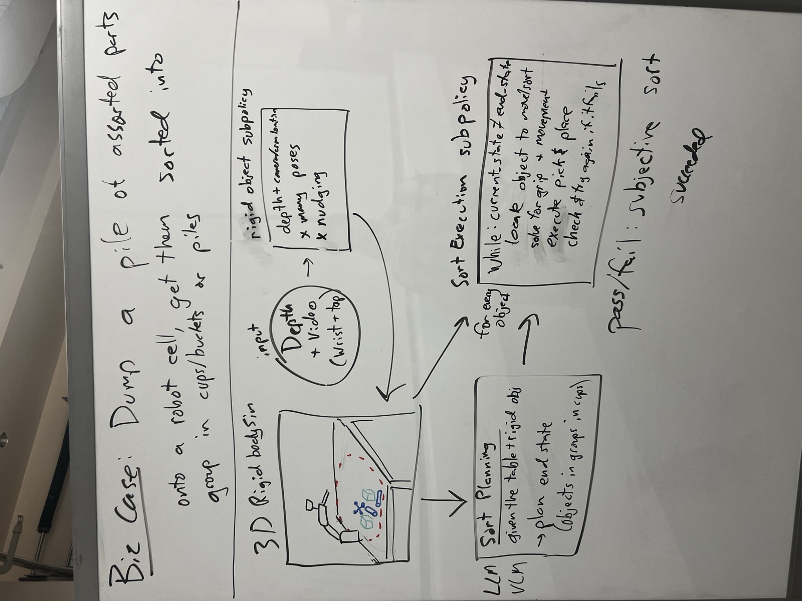
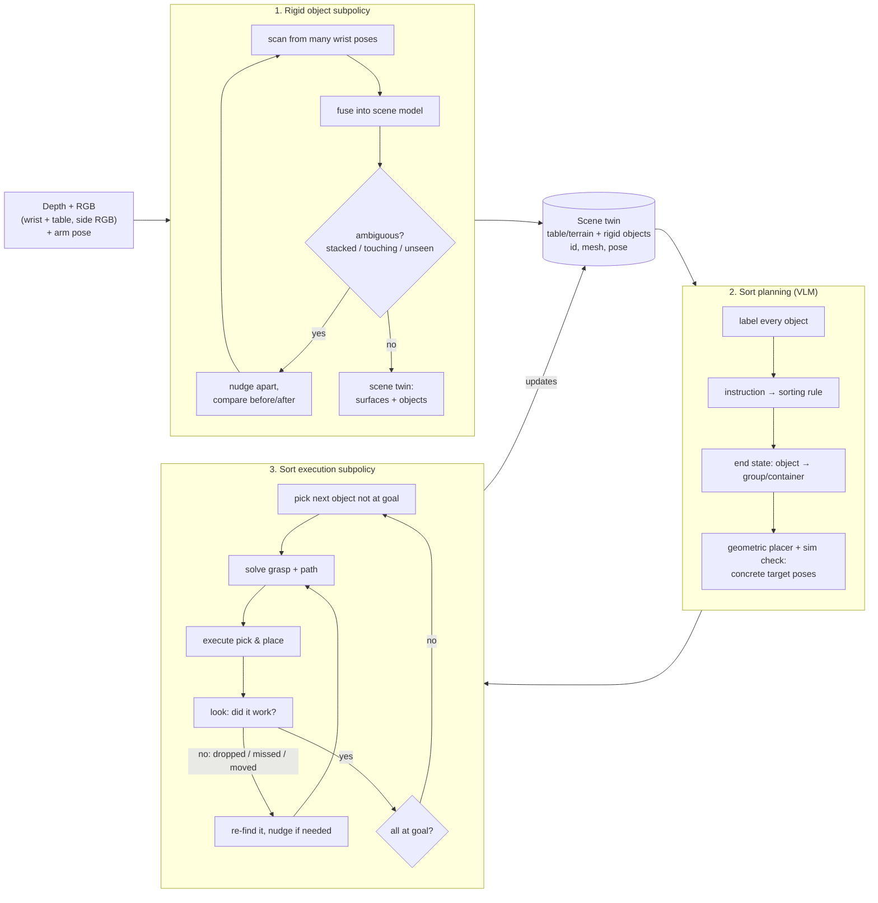

# Architecture

**Business case:** dump a pile of assorted rigid parts onto a robot cell, and get them sorted into groups (in cups, in buckets,
or in piles) from a plain-language instruction, the way you'd brief an intern:

- "Sort these." With no rule given, the system invents one from the objects and says it up front.
- "Use the cups on the side."
- "I don't care what they are, sort by color."
- "Same shape goes together, ignore color." Ten 2×4 Lego bricks in five colors all go in one bucket.

No reprogramming per part, and no per-object training.



## Two streams

This follows the brain's two visual streams (Milner & Goodale): one for **what** something is, one for **where it is and how to act on it**.

| | Dorsal: "where / how" | Ventral: "what" |
|---|---|---|
| Built from | Depth (mostly the wrist camera, moved by the arm), arm pose, nudges | RGB from the table, side and wrist cameras |
| Knows | Every rigid object's 3D shape, pose and supports; where it can be gripped; how it rests | Names, colors, categories, function ("blue 2×4 Lego", "toy soldier") |
| Doesn't know | What anything *is* | Where anything is, precisely |
| Implemented by | Geometry, registration, physics. No learning required. | A vision-language model |

The two meet at **object IDs**. The dorsal stream creates object `#7` with a mesh and a pose. The ventral stream attaches
`{"name": "blue 2x4 Lego brick", "color": "blue", ...}` to `#7`. The VLM never outputs coordinates, and the motion code never needs names.

## Three phases



### Phase 1: Rigid object subpolicy (dorsal)

**Goal:** a scene twin where every object is separate and known in 3D, like laying out jigsaw pieces before solving the puzzle.
Nudges serve understanding, not sorting. Knocking something over, or briefly making the table messier, is fine.

- **Input:** depth images, RGB, and the arm pose for each image. The wrist camera does most of the work because it moves: with the fingers down
  it sits about 100 mm ahead of the fingertip and about 240 mm above the table, and sees roughly 1 mm detail. The table camera gives a coarse
  first look, about 2–3 mm per pixel, with screws close to invisible.
- **Surfaces first:** fit the table plane (and, later, steps, trays and box floors as extra planes or a height field). Anything resting on a
  surface and sticking up from it is a candidate object. A flat table is assumed for v1.
- **Loop:** scan, fuse, find what's uncertain, then either look again from a better pose or nudge. Stop when every object is
  *singulated*: separated from its neighbors, nothing stacked, all sides seen well enough to grip.
- **What triggers a nudge:**
  - a blob too big or too oddly shaped to be one part;
  - the VLM saying "that's 9 cubes" about one slab;
  - something stacked on something else;
  - an object with no clear finger slots.
- **How a nudge is read (common fate):** compare the 3D scene before and after. Points that moved together by one rigid motion are one
  object; points that didn't move belong to something else.
- **Output:** the scene twin. Surfaces, plus for each object: `id`, mesh or point cloud, pose, size, the views it was seen from,
  and a confidence.

### Phase 2: Sort planning (ventral + planner)

- **Label:** with the objects spread out, take crops from the table, side and wrist cameras. Each crop is projected from the twin, so
  each one is tied to an `id`. Overlay the IDs as numbers on the image (*Set-of-Mark* prompting). Ask the VLM for a name, color,
  category and anything notable, per ID.
- **Rule:** the VLM turns the instruction and the labelled objects into a sorting rule, which it **states before anything moves**:
  "Group by shape: bricks in cup A, screws in cup B." That statement is also what pass/fail is judged against: did it follow its own
  rule, and is the rule sensible?
- **End state:** a symbolic assignment (`#7 → cup A`, `#3 → pile 2`), then a **geometric placer** turns it into concrete, reachable,
  collision-free target poses. A physics check confirms each object will stay where it's put: stable resting pose, fits inside the cup.
  The VLM picks *what goes where*; geometry decides *exactly where*.

### Phase 3: Sort execution subpolicy (dorsal again)

```
while scene ≠ end state:
    obj  = next object not at its goal          (nearest, unblocked first)
    g    = best grasp on obj                     (analytic search on its shape; sim check)
    path = approach → grasp → lift → carry → place → release → retreat
    execute
    look again (wrist camera at source and target)
    if obj not at goal:                           (dropped, missed, knocked)
        re-find obj (where it was, where it should be, nearby; match by shape)
        if no good grasp exists: nudge it to a better pose
```

Errors are expected and handled, not fatal. The same loop shape works at every level:
"arrange 10 parts" → "move #4 to cup A" → "free #4, grasp, verify".

## Internal tools we need

| Tool | Does | Notes |
|---|---|---|
| **Scene model** | The shared data structure: surfaces plus objects (id, geometry, pose, confidence, labels). Everything reads and writes it. | Plain Python dataclasses, saved as JSON + meshes so runs can be replayed. |
| **Static fusion** | Many depth images + camera poses → one 3D scene | TSDF fusion (Open3D). Already prototyped as a height map in `cell/lab/scene_viewer.py`. |
| **Dynamic fusion** | The same, while objects move between images | One TSDF per object; each nudge updates that object's pose by registration (ICP). |
| **Motion segmentation** | Before/after a nudge → which points moved together | Multi-model rigid registration: repeatedly find the dominant rigid motion and peel it off (RANSAC + ICP). |
| **Surface finder** | Table, steps, tray floors | RANSAC planes (Open3D `segment_plane`), or a height field. |
| **View planner** | Where to put the wrist camera next to see what's unknown | Start simple: a grid sweep, then visit unknown or uncertain regions. Must account for the 100 mm camera offset. |
| **Grasp finder** | Object shape → ranked finger placements | Analytic: opposing surfaces under 12 mm apart, both finger slots clear on the way in and out. Height map first, full 3D later. |
| **Push planner** | Where and which way to push to separate or rotate something | Rule-based to start: push along the line away from neighbors, through the center to slide, off-center to turn. |
| **Placer** | "Put #7 in cup A" → a concrete, reachable, stable pose | Free-space search on the height map + stable poses (trimesh). |
| **Physics check** | "If I grip here and lift, does it hold?" / "If I set it down like this, does it stay?" | MuJoCo with a floating gripper (no arm needed). |
| **Motion primitives** | `look(point)`, `pick(grasp)`, `place(pose)`, `push(start, dir, mm)` → waypoint lists | The cell does the inverse kinematics already (tcp mode). We add safe-height routing, collision checks and the 0.8 s lag. |
| **Verifier** | "Did it work?": compare the expected scene with a fresh scan | Re-scan source and target, match by shape. |
| **VLM interface** | Object crops with ID marks → labels; instruction → rule → assignment | Structured JSON in and out; every prompt and answer logged. |
| **Inspector** | See what the system believes at every step | Rerun: point clouds, meshes, grasps, pushes, plans, VLM answers on one timeline. |
| **Trial log** | Every rollout: code version, setup, outcome, interventions | Required by the judges; CSV + Rerun files. |

## Simulation: which one, for what

There are **two different twins**:
- **The organizers' twin** (Isaac Sim, `fanuc_er4ia_sim.zip`): the arm and cell, calibrated to the real cameras. Use it as a
  **test harness**: drop objects in, render depth and RGB like the real cameras, and run the full pipeline before spending a slot.
- **Our scene twin:** the model of *what's on the table right now*, built by phase 1. It needs fast what-if physics, not pretty rendering.

| Simulator | Good for | Cost |
|---|---|---|
| **MuJoCo** (DeepMind, free) | The scene twin's what-if checks: grasp holds, object rests stably, push outcome. Fast on a CPU, simple Python API. | Needs objects as convex pieces (CoACD). Contact on noisy scanned meshes is approximate. |
| **PyBullet** | The same; older and simpler; lots of grasping examples | Less accurate contact than MuJoCo; little active development. |
| **Isaac Sim / Isaac Lab** (NVIDIA, PhysX) | The organizers' twin; photoreal camera rendering; GPU-parallel; sponsor alignment | Heavy. Runs headless on a Spark (arm64 images exist) or on Brev. Slow to iterate on. |
| **ManiSkill3 / SAPIEN, Genesis** | GPU-parallel manipulation research | More to learn; not needed here. |

**Plan:** MuJoCo on the Mac for the scene twin's checks. Isaac Sim (on a Spark) as the end-to-end test harness, if time allows.
Mention Isaac Sim in the story only for what we actually used it for.

**"Go grab it" without writing joint policies:** two things make this simple.
1. On the real cell, `ACTION = "tcp"` means we command the fingertip pose and the FANUC controller does the inverse kinematics.
   Our primitives just produce fingertip waypoints.
2. In simulation, use a **floating gripper**: the two fingers alone, moved directly. That's the standard way to test grasps, with
   no robot model needed. Check arm reach separately (stay within 550 mm, tool pointing down or slightly tilted).

## Reading list

**Perception and 3D reconstruction**
- Open3D docs: point clouds, normals, RANSAC planes, DBSCAN clustering, ICP registration, TSDF integration, mesh smoothing
  (`filter_smooth_taubin`) and simplification (`simplify_quadric_decimation`).
- Curless & Levoy 1996, *A Volumetric Method for Building Complex Models from Range Images*: the original TSDF fusion.
- KinectFusion (Newcombe et al. 2011): real-time TSDF + ICP.
- Co-Fusion (Rünz & Agapito 2017) and MaskFusion (Rünz et al. 2018): reconstruct **multiple moving rigid objects** separately.
  Closest to our dynamic fusion.
- BundleSDF (Wen et al., NVIDIA, 2023): track and reconstruct an unknown object from RGB-D at the same time.
- FoundationPose (Wen et al., NVIDIA, 2024): 6-DoF pose tracking of novel objects. Useful for "find the object I just had".
- SAM 2 (Meta, 2024): segment anything in images and video. Splits RGB seams that depth can't see; masks for the VLM crops.

**Interactive perception and pushing**
- Bohg et al. 2017, *Interactive Perception: Leveraging Action in Perception and Perception in Action* (IEEE T-RO): the survey.
- Zeng et al. 2018, *Learning Synergies between Pushing and Grasping* (Visual Pushing for Grasping): push to make room, on height maps.
- Mason 1986, *Mechanics and Planning of Manipulator Pushing Operations*; Lynch & Mason 1996, *Stable Pushing*:
  quasi-static pushing, slide vs. rotate.
- Spelke 1990, *Principles of Object Perception*: cohesion and common fate.

**Grasping**
- Antipodal grasps and friction cones: any robotics grasping chapter (e.g. Lynch & Park, *Modern Robotics*, ch. 12).
- GPD (ten Pas et al. 2017), Dex-Net 2.0 (Mahler et al. 2017), Contact-GraspNet (Sundermeyer et al. 2021),
  AnyGrasp (Fang et al. 2023): learned grasp detection, all for wider grippers than ours.
- trimesh docs: `compute_stable_poses`, center of mass, ray tests. CoACD: convex decomposition for simulation.

**Language and vision for robots**
- Set-of-Mark prompting (Yang et al. 2023): number regions in an image so a VLM can refer to them. How IDs get labels.
- TidyBot (Wu et al. 2023): an LLM infers sorting rules from a few examples, then a robot tidies by them. Closest prior work to the business case.
- Code as Policies (Liang et al. 2022), VoxPoser (Huang et al. 2023), ReKep (Huang et al. 2024): LLMs and VLMs producing robot plans
  and constraints instead of motor commands.
- Task and motion planning (TAMP), e.g. PDDLStream (Garrett et al. 2020): the classic framing of symbolic plans plus geometric checks.
- Milner & Goodale, *The Visual Brain in Action*: the two-streams hypothesis.

**Simulation and motion**
- MuJoCo docs and tutorials (Python bindings); PyBullet quickstart.
- Isaac Sim / Isaac Lab on DGX Spark: https://build.nvidia.com/spark/isaac
- cuRobo (NVIDIA): GPU motion generation, if we ever need real collision-aware arm planning. tcp mode likely makes it unnecessary.

## What's real today

- `cell/policy.py`: blind baseline (one screw, known coordinates). Passes the mock.
- `cell/lab/scene_viewer.py`: synthetic scene → real camera calibrations → fused point cloud and height map → Rerun.
- Everything else above is design.
